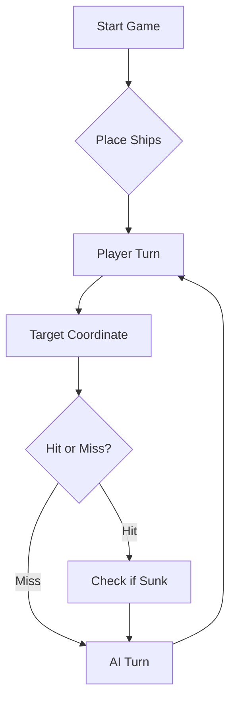

# ⚓ Battleship 2.0


> A modern take on the classic naval warfare game, designed for the XVII century setting with updated software engineering patterns.

---

## 📖 Table of Contents
- [Project Overview](#-project-overview)
- [Key Features](#-key-features)
- [Technical Stack](#-technical-stack)
- [Installation & Setup](#-installation--setup)
- [Code Architecture](#-code-architecture)
- [Roadmap](#-roadmap)
- [Contributing](#-contributing)

---

## 🎯 Project Overview
This project serves as a template and reference for students learning **Object-Oriented Programming (OOP)** and **Software Quality**. It simulates a battleship environment where players must strategically place ships and sink the enemy fleet.

### 🎮 The Rules
The game is played on a grid (typically 10x10). The coordinate system is defined as:

$$(x, y) \in \{0, \dots, 9\} \times \{0, \dots, 9\}$$

Hits are calculated based on the intersection of the shot vector and the ship's bounding box.

---

## ✨ Key Features
| Feature | Description | Status |
| :--- | :--- | :---: |
| **Grid System** | Flexible $N \times N$ board generation. | ✅ |
| **Ship Varieties** | Galleons, Frigates, and Brigantines (XVII Century theme). | ✅ |
| **AI Opponent** | Heuristic-based targeting system. | 🚧 |
| **Network Play** | Socket-based multiplayer. | ❌ |

---

## 🛠 Technical Stack
* **Language:** Java 17
* **Build Tool:** Maven / Gradle
* **Testing:** JUnit 5
* **Logging:** Log4j2

---

## 🚀 Installation & Setup

### Prerequisites
* JDK 17 or higher
* Git

### Step-by-Step
1. **Clone the repository:**
   ```bash
   git clone [https://github.com/britoeabreu/Battleship2.git](https://github.com/britoeabreu/Battleship2.git)
   ```
2. **Navigate to directory:**
   ```bash
   cd Battleship2
   ```
3. **Compile and Run:**
   ```bash
   javac Main.java && java Main
   ```

---

## 📚 Documentation

You can access the generated Javadoc here:

👉 [Battleship2 API Documentation](https://britoeabreu.github.io/Battleship2/)


### Core Logic
```java
public class Ship {
    private String name;
    private int size;
    private boolean isSunk;

    // TODO: Implement damage logic
    public void hit() {
        // Implementation here
    }
}
```

### Design Patterns Used:
- **Strategy Pattern:** For different AI difficulty levels.
- **Observer Pattern:** To update the UI when a ship is hit.
</details>

### Logic Flow


---

## 🗺 Roadmap
- [x] Basic grid implementation
- [x] Ship placement validation
- [ ] Add sound effects (SFX)
- [ ] Implement "Fog of War" mechanic
- [ ] **Multiplayer Integration** (High Priority)

---

## 🧪 Testing
We use high-coverage unit testing to ensure game stability. Run tests using:
```bash
mvn test
```

> [!TIP]
> Use the `-Dtest=ClassName` flag to run specific test suites during development.

---

## 🤝 Contributing
Contributions are what make the open-source community such an amazing place to learn, inspire, and create.

1. Fork the Project
2. Create your Feature Branch (`git checkout -b feature/AmazingFeature`)
3. Commit your Changes (`git commit -m 'Add some AmazingFeature'`)
4. Push to the Branch (`git push origin feature/AmazingFeature`)
5. Open a **Pull Request**

---

## 📄 License
Distributed under the MIT License. See `LICENSE` for more information.

---
**Maintained by:** [@britoeabreu](https://github.com/britoeabreu)  
*Created for the Software Engineering students at ISCTE-IUL.*

## Prompt final da estratégia do LLM

Considere agora a seguinte tática de geração de rajadas de tiros.

**1. Diário de Bordo.** Registe cada rajada, numerada (Rajada 1, 2, 3...), com as
coordenadas exatas dos 3 tiros e o resultado recebido. Mantenha também um mapa
mental do tabuleiro com: água confirmada, navios afundados e respetivo halo.
A memória é a principal arma de um bom estratega.

**2. Sem desperdício.** Nunca dispare fora do mapa nem repita coordenadas. A única
exceção é a última rajada, só para completar os 3 tiros obrigatórios.

**3. Fase de procura.** Enquanto não houver navios atingidos por afundar, dispare
em xadrez (quadrículas alternadas), espalhando os 3 tiros por zonas diferentes e
nunca dentro do halo de navios afundados.

**4. A resposta é da rajada inteira, não de cada tiro.** Se a resposta disser
"1 tiro num Galeão", qualquer um dos 3 tiros pode ter acertado. Nesse caso,
trate os 3 tiros como candidatos e escolha a próxima rajada para distinguir as
hipóteses (por exemplo, um tiro junto a cada candidato).

**5. Conte sempre os acertos.** Acertos da rajada = validShots − missedShots.
Atenção: se um tipo de navio afundar numa rajada, um acerto noutro navio do
mesmo tipo pode não aparecer em hitsOnBoats, mas entra nesta conta.

**6. Use as regras para eliminar hipóteses.** Os navios nunca se tocam, nem na
diagonal. Se dois candidatos de navios diferentes ficariam encostados, essa
combinação é impossível. As diagonais de um tiro certeiro são água, exceto no
Galeão (forma em T).

**7. Caça ao navio.** Depois de um acerto confirmado, dispare nas posições
contíguas (Norte, Sul, Este, Oeste) até descobrir a orientação e afundar o navio.
Com 2 acertos em linha, continue só nessa linha. Para o Galeão, considere as
4 orientações possíveis do T e elimine as que contradizem o Diário de Bordo.

**8. Halo dos afundados.** Quando um navio afundar, identifique no Diário de
Bordo as posições exatas da carcaça e marque o halo de 1 posição em redor como
água. É impossível haver outro navio nesse perímetro.

**9. Final do jogo.** Mantenha a lista dos navios que ainda faltam. Dispare só
onde esses navios ainda cabem (ex.: uma Caravela precisa de 2 quadrículas livres
seguidas, fora de qualquer halo).

**10. Honra.** Se a sua frota for afundada, declare a derrota com honra. Se for a
do inimigo, seja um vencedor magnânimo.

### Exemplos (few-shot)

**Exemplo A: acerto sem saber qual tiro.**
Rajada: E5, B8, H3. Resposta: validShots 3, missedShots 2, hitsOnBoats Galeao 1.
Correto: E5, B8 e H3 são todos candidatos. Próxima rajada: um vizinho de cada
(ex.: E6, B9, H4), para descobrir qual foi o tiro certeiro.

**Exemplo B: acerto escondido.**
Rajada: F8, H6, D6. Resposta: validShots 3, missedShots 1, sunkBoats Nau 1,
hitsOnBoats vazio.
Correto: houve 3 − 1 = 2 acertos. Um afundou a Nau já atingida; o outro (D6)
acertou na segunda Nau. Na próxima rajada, caçar à volta de D6.

**Exemplo C: eliminar pelo halo.**
Restam 1 Caravela e 2 Barcas. A Caravela só cabe onde houver 2 quadrículas
livres seguidas fora de halos. Se só existirem duas zonas assim, dispare apenas
nessas zonas.